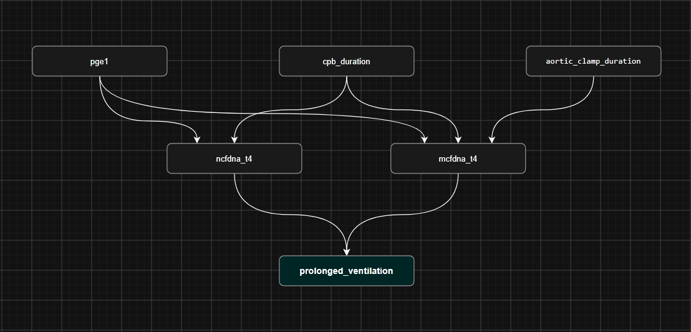

# Байесовские сети для прогнозирования продлённой ИВЛ

Реализация байесовской сети на Go для прогнозирования продлённой искусственной вентиляции лёгких (ИВЛ ≥ 24 ч) у младенцев после хирургической коррекции коарктации аорты.

## Назначение

Скрипт читает данные из файла `База Коарктации ДНК.xlsx`, дискретизирует непрерывные переменные, обучает байесовскую сеть со сглаживанием Дирихле, делает прогноз для отдельного пациента и оценивает качество модели методом leave-one-out cross-validation (LOOCV).

**Целевая переменная:** `prolonged_ventilation` - продлённая ИВЛ >= 24 ч.

**Прямые родители:** `ncfdna_t4`, `mcfdtgna_t4` - ядерная и митохондриальная внеклеточная ДНК в точке T4 (после ИК).

**Косвенные узлы:** `pge1`, `ik_duration`, `clamp_duration`.

## Структура проекта

```
baies/
    go.mod              # модуль Go
    main.go             # точка входа
    data/
        data.go         # загрузка xlsx, дискретизация
    bn/
        bn.go           # обучение, прогноз
    metrics/
        metrics.go      # LOOCV, метрики
    output/
        output.go       # вывод
```


## Зависимости
`go mod tidy` для установки зависимостей:

1. `github.com/JohnPierman/bngo` - базовая работа с байесовскими сетями
2. `github.com/xuri/excelize/v2` - чтение xlsx  

Также для запуска требуется файл `База Коарктации ДНК.xlsx` в корне проекта.
## Запуск
`go run main.go`.


## Описание пакетов

### data — загрузка и дискретизация

**LoadSamples(path, sheet string) ([]map[string]int, error)**

Читает xlsx, извлекает шесть столбцов, дискретизирует переменные, возвращает список пациентов.

Читаемые столбцы:

| Переменная | Столбец | Описание |
|---|---|---|
| pge1 | I | Применение простагландина E1 |
| ik_duration | Z | Длительность ИК (мин) |
| clamp_duration | AA | Длительность пережатия аорты (мин) |
| ncfdna_t4 | DA | Ядерная cfDNA в T4 |
| mcfdna_t4 | DE | Митохондриальная cfDNA в T4 |
| prolonged_ventilation | BE | Длительность ИВЛ (час) |

**Дискретизация:**

| Переменная | Категории | Пороги |
|---|---|---|
| pge1 | 0 / 1 | нет / да |
| ik_duration | 0 / 1 | < 120 / ≥ 120 мин |
| clamp_duration | 0 / 1 | < 30 / ≥ 30 мин |
| ncfdna_t4 | 0 / 1 / 2 | низкий / средний / высокий (по квартилям) |
| mcfdna_t4 | 0 / 1 / 2 | низкий / средний / высокий (по квартилям) |
| prolonged_ventilation | 0 / 1 | < 24 / ≥ 24 ч |

**Пропуски**: если хотя бы одна переменная не дискретизирована — пациент исключается.

### bn — обучение и прогноз

**BuildNetwork(edges) (\*models.BayesianNetwork, error)**

Создаёт байесовскую сеть с заданной структурой.

**Fit(bn, samples, alpha, edges) error**

Обучает CPT для каждого узла. Реализует сглаживание Дирихле (в bngo его нет):

```
P(категория | родители) = (N + a) / (N_общ + a × K)
```

Параметры:
- a — параметр сглаживания (a = 1)

**Predict(bn, evidence, target) ([]float64, error)**

Возвращает вероятности целевой переменной при заданных свидетельствах.

### metrics — метрики

**LOOCV(edges, samples, alpha) (Result, error)**

*Leave-One-Out Cross-Validation.*

Возвращает:

| Поле | Описание |
|---|---|
| Total | Число пациентов |
| TP, FP, FN, TN | Число верных и неверных срабатываний |
| Accuracy | Доля правильных предсказаний |
| Precision | Из предсказанных «ИВЛ ≥ 24 ч» — доля подтвердившихся |
| Recall | Из реальных «ИВЛ ≥ 24 ч» — доля найденных |
| F1 | Среднее Precision и Recall |

### output — вывод CPT

**PrintCPD(cpd \*factors.TabularCPD)**

Печатает таблицу условных вероятностей в читаемом виде.

Формат:

```
prolonged_ventilation
ncfdna_t4  mcfdna_t4  P(<24ч)  P(>=24ч)
низкий     низкий     0.8000   0.2000
...
```

## Структура сети



Рёбра (7):

| № | Источник | Целевой узел |
|---|---|---|
| 1 | pge1 | ncfdna_t4 |
| 2 | pge1 | mcfdna_t4 |
| 3 | ik_duration | ncfdna_t4 |
| 4 | ik_duration | mcfdna_t4 |
| 5 | clamp_duration | mcfdna_t4 |
| 6 | ncfdna_t4 | prolonged_ventilation |
| 7 | mcfdna_t4 | prolonged_ventilation |


## Метрики

Пример результата на текущих данных (N = 29):

| Метрика | Значение |
|---|---|
| Accuracy | 0.7931 |
| Precision | 0.8000 |
| Recall | 0.9524 |
| F1 | 0.8696 |


* TP = 20 
* FP = 5
* FN = 1
* TN = 3

Переменные: 
* Предсказанное положительное верно - TP
* Предсказанное положительное неверно - FP
* Предсказанное негативное неверно - FN
* Предсказанное негативное верно - TN
